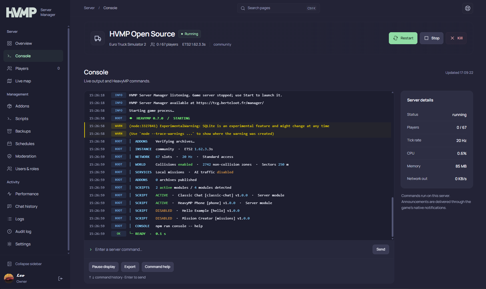
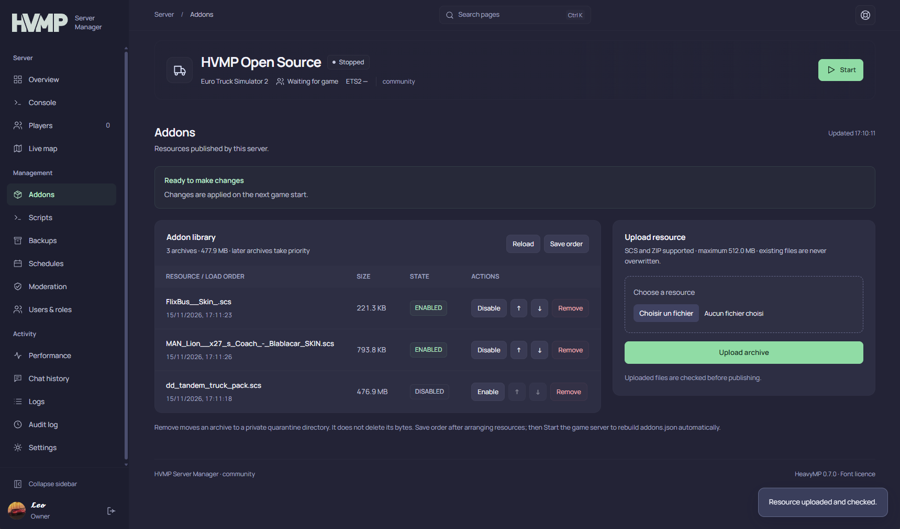
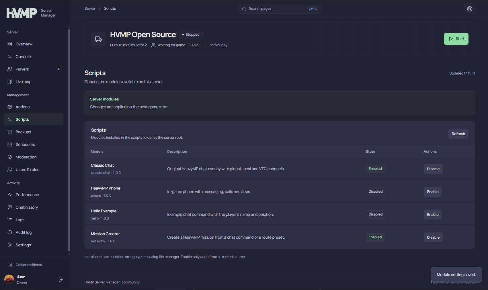

<p align="center"></p>

# HeavyMP Server

Self-hosted multiplayer server for Euro Truck Simulator 2. This source edition
includes the **HVMP Server Manager**, the game relay, community scripts, addon
distribution and the discovery adapter for a launcher. Version 1.0.2 supports
ETS2 1.62.3.3s and works with the
[HeavyMP Launcher](https://github.com/FarboundStudios/launcher).

**1.0.2** fixes freight job trailers: trailers supplied by the game (lowbeds,
tankers, curtain siders and other `def/vehicle/trailer/` trailers) and their
loads are now shared with other players. Players need launcher 1.0.3.

## Run a server

Use Node.js 22.13 or newer with npm. From the project directory:

```sh
cp .env.example .env
npm ci
```

On Windows, use `Copy-Item .env.example .env` for the first command. Then
[declare the owner](#manager-accounts-and-roles) in `data/manager-access.json`
and start the server:

```sh
npm start
```

Open `http://127.0.0.1:30007/manager/`, sign in with Steam and click **Start**.
Use the exact address set in `MANAGER_PUBLIC_URL`. The Manager and the game
share the same port. After a full process restart the game stays stopped until
an operator starts it.

## Manager accounts and roles

No account can sign in by default. Administrators sign in through Steam, and
the Manager checks its local lists.

**Owners** are declared in `data/manager-access.json` (in `DATA_DIR`), with
their SteamID64 (17 digits, up to 100 accounts). Create the file, then restart
the server:

```json
{"schema":1,"admins":["76561198000000001"]}
```

Alternatively, set `MANAGER_ADMIN_STEAM_IDS` in the environment, as a comma
separated list. Use one method only: when the variable is defined, **even
empty**, the file is ignored. It is commented out in `.env.example`.

**Other staff** are added by an owner on the **Access** page of the Manager.
They are saved in `data/manager-users.json`; no restart is needed. Owners
cannot be changed or removed from that page.

| Role | Access | Start / stop |
| --- | --- | --- |
| Owner | Everything, including **Access** | Yes |
| Administrator | Everything except **Access** | Yes |
| Operator | Overview, players, map, performance, console, logs | Yes |
| Moderator | Overview, players, map, performance, chat, moderation | No |
| Viewer | Overview, players, map, performance | No |

These roles apply to the Manager only. In-game staff is configured with client
fingerprints (see below).

## Hosting

On a Node hosting panel, choose Node.js 22 or later, set the installation
command to `npm ci` and the start command to `npm start`. Bind `HOST=0.0.0.0`
when the hosting proxy runs outside the Node container. Use the internal port
assigned by the host and set `MANAGER_PUBLIC_URL` to your public HTTPS origin.

For an internet-facing instance, configure the server name and ID, the
`PUBLIC_HOST`, `PUBLIC_PORT` and the site's HTTPS origin in
`MANAGER_PUBLIC_URL`. Forward the same origin to the Node server with a TLS
reverse proxy that supports WebSocket upgrades. For example, a basic Caddy
site on the same machine can use:

```caddyfile
server.example.org {
    reverse_proxy 127.0.0.1:30007
}
```

**The HeavyMP Launcher needs HTTPS to join a server.** A plain
`http://localhost` address is only listed and monitored. For a public server,
set for example, then restart:

```dotenv
MANAGER_PUBLIC_URL=https://server.example.org
PUBLIC_HOST=server.example.org
PUBLIC_PORT=443
```

After sign-in, the Manager reads the display name and avatar from Steam
Community. If the hosting provider cannot reach the public profile,
the Manager logs the failure and uses the saved display details if available.
To set a fallback, create `data/manager-profiles.json` and restart the Manager.
Use the following format, with your SteamID64 and display name. You can add an
`avatar` field with a Steam avatar URL.

```json
{"schema":1,"profiles":{"76561198000000001":{"name":"My Steam nickname"}}}
```

Players connect directly to this instance through a compatible client. Chat,
VTC, missions and phone numbers use local storage.

A compatible client persists a private token. To get its public fingerprint
with the included client, configure `client/config.json` from
`client/config.example.json`, then run `npm run client:fingerprint`. Use that
fingerprint in `STAFF_IDENTITIES` or in `missionCreators` for Mission Creator.
Keep the private identity file. Persistent game moderation applies to a
client identity. Players who create a different identity have a new one.

## Launcher discovery

A launcher adds this instance using the Manager's public HTTPS address. The
API describes one instance and stays available while the game is stopped.
See [the discovery API and integration example](docs/discovery.md).

```sh
npm run discover -- http://127.0.0.1:30007
```

The existing `/health`, `/servers`, `/players`, `/content/manifest`,
addon downloads and game WebSocket retain their existing contracts. A stopped
game still returns HTTP 503 through the game routes. The public discovery
endpoint reports stopped instances with HTTP 200.

## Addons, scripts and operations

- Place `.scs` and `.zip` addons in `addons/`. The game process verifies and
  indexes them on Start. For a standalone map, set `MAP_MODULE` to its MBD
  stem and use a matching ETS2 profile. If non-collision zones are enabled,
  use a catalogue for that exact map.
- The phone ships with local numbers and messaging. Operators can optionally
  run their own shared phone hub. Its directory and credentials belong to
  the participating instances.
- Add scripts under `scripts/<name>/` and manage them in **Scripts**. The
  built-in chat, phone, mission example and hello module are included.
- Use the Manager for the console, player list, live map, settings, backups,
  schedules, logs and moderation. The operator CLI is also available via
  `npm run console -- help`.
- To update from source, stop the Manager and its game process, back up
  `.env`, `data/`, `addons/` and your custom scripts, update the checkout,
  run `npm ci`, then start the Manager and game again.
- For migration from a website-linked installation, use the new
  `.env.example` and migrate your local settings. Preserve the previous
  database and resolve outstanding website deliveries in that installation.
  Existing records linked to a Steam account have no automatic match to a
  standalone client token. Configure local staff fingerprints before enabling
  staff-only access.

## Development and licensing

Run `npm test` for the server and discovery tests. The tests simulate Steam sign-in and exercise the public endpoints locally.

© 2026 [HeavyMP.com](https://heavymp.com), a project of [Farbound Studios](https://farboundstudios.com).
Server and Manager source are under the [HeavyMP Open License](LICENSE): MIT,
plus one condition. You may use, modify and redistribute it freely, but your
server or product must say that it is **built with HeavyMP** (README, a place
your users see, and your release announcements). See the license for the exact
rules and the sentence to use:

> Built with HeavyMP - https://heavymp.com

Bundled third-party files keep their own notices. The repository excludes game
archives, the native ETS2 plugin, the Windows launcher distribution and
private instance data. The `launcher/` directory here contains the discovery
adapter and its command-line example.

## Screenshots




